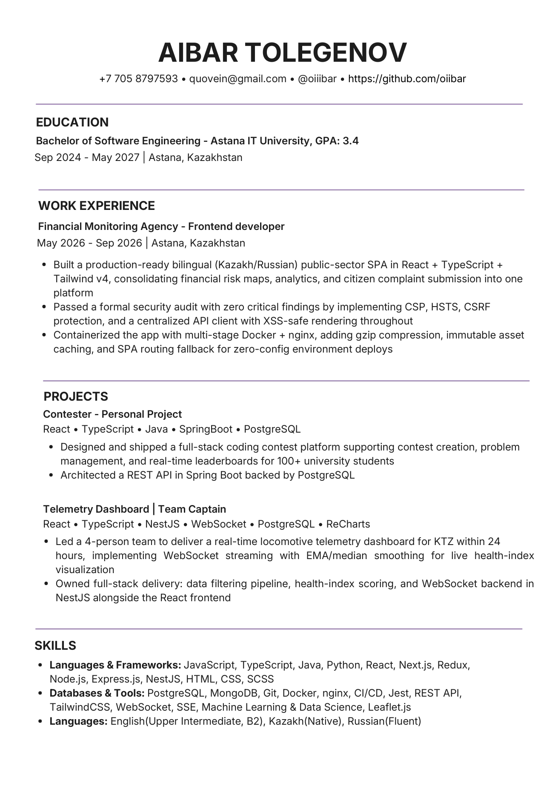

<h1 align="center">Aibar Tolegenov</h1>
<h3 align="center">Full-Stack Developer · React / TypeScript / NestJS / Go / Spring Boot</h3>

  
  
  
  
  
  

  

---

## About

Final-year Software Engineering student at Astana IT University (graduating 2027) based in Astana, Kazakhstan. I build full products end to end: React and TypeScript frontends, NestJS, Spring Boot and Go backends, PostgreSQL, and Docker/Kubernetes deployments.

My latest work is a public-sector web app for the Financial Monitoring Agency of Kazakhstan that passed a formal security audit with zero critical findings. I also built a contest platform with a sandboxed judge, a Go microservices backend, and a 24-hour hackathon dashboard for KTZ as team captain.

Looking for a full-stack, frontend or backend role.

---

## Experience

### Frontend Developer, Financial Monitoring Agency of Kazakhstan
**Apr 2026 – Sep 2026 · Astana**

- Built a bilingual (Kazakh / Russian) public-sector web app in React, TypeScript and Tailwind CSS that combines financial risk maps, analytics and citizen complaint submission in one platform.
- Implemented citizen and staff interfaces with role-based workflows and an API layer written against a documented OpenAPI contract.
- Passed a formal security audit with zero critical findings after adding CSP, HSTS and CSRF protection and moving all requests to one API client with XSS-safe rendering.
- Packaged the app with multi-stage Docker and nginx (gzip, asset caching, SPA routing fallback).

---

## Selected Projects

| Project | Stack | Summary |
|---|---|---|
| [**Contester**](https://github.com/oiibar/Contester) | React · TypeScript · Java 21 · Spring Boot · PostgreSQL · Docker | Programming contest platform. A sandboxed judge (Piston) runs submissions in Python, JavaScript, Java or C++ against hidden tests with time and memory limits. ICPC-style live standings, rejudging tools, GitHub Actions CI. |
| [**CommerceMesh**](https://github.com/oiibar/CommerceMesh) | Go · gRPC · NATS · PostgreSQL · Redis · OpenTelemetry | E-commerce backend split into four Go services behind a REST gateway with JWT auth. Transactional checkout releases reserved stock on failure; requests are traced across services with Jaeger. |
| [**Wisely**](https://github.com/oiibar/Wisely) | React · Redux Toolkit · NestJS · TypeORM · PostgreSQL · Playwright | Budget manager with monthly budgets, charts and CSV export. Argon2id, HttpOnly JWT cookies, rotating refresh tokens, idempotent writes, full test suite in CI. |
| [**TelemetryDashboard**](https://github.com/oiibar/TelemetryDashboard) | React · TypeScript · NestJS · Socket.IO · PostgreSQL | Real-time locomotive telemetry dashboard for KTZ, built in 24 hours as captain of a 4-person team. EMA / median filtering and a 0-100 health score with an A-E grade. |
| [**Commit Guard**](https://github.com/oiibar/commit-guard) | FastAPI · CodeBERT · Semgrep · browser extension | Diploma project: filters false-positive Semgrep alerts on GitHub commits with a CodeBERT classifier. |

More repositories at [github.com/oiibar](https://github.com/oiibar?tab=repositories).

---

## Skills

**Frontend**

  
  
  
  
  
  
  
  
  

**Backend**

  
  
  
  
  
  
  
  
  
  

**Databases**

  
  
  
  
  

**DevOps & Tools**

  
  
  
  
  
  
  
  
  

**Testing**

  
  
  
  

**Spoken languages:** Kazakh (native) · Russian (fluent) · English (B2, upper-intermediate)

---

## Education

**Bachelor of Software Engineering**, Astana IT University, Astana, Kazakhstan
Sep 2024 – May 2027 · GPA 3.4 / 4.0

---

## Curriculum Vitae

  

  <a href="CV.pdf"><b>Open full CV (PDF)</b></a>

---

## GitHub Activity

  

  
  

  

---

  Open to full-stack, frontend and backend roles. Reach me at <a href="mailto:quovein@gmail.com">quovein@gmail.com</a> or <a href="https://t.me/oiiibar">@oiiibar</a> on Telegram.

